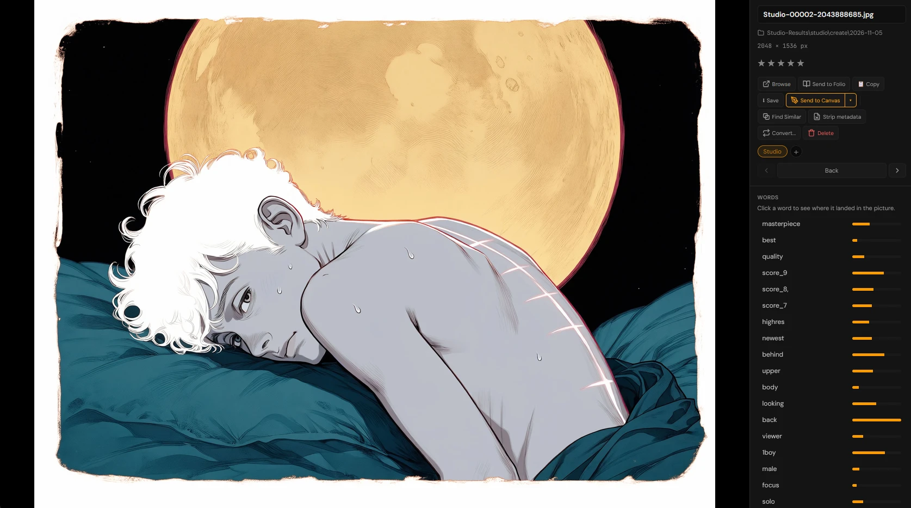
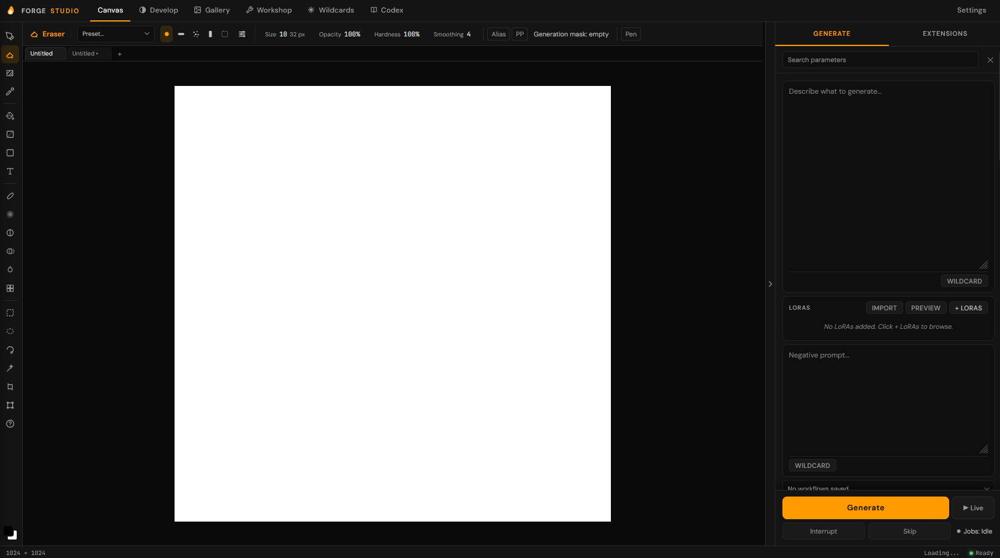
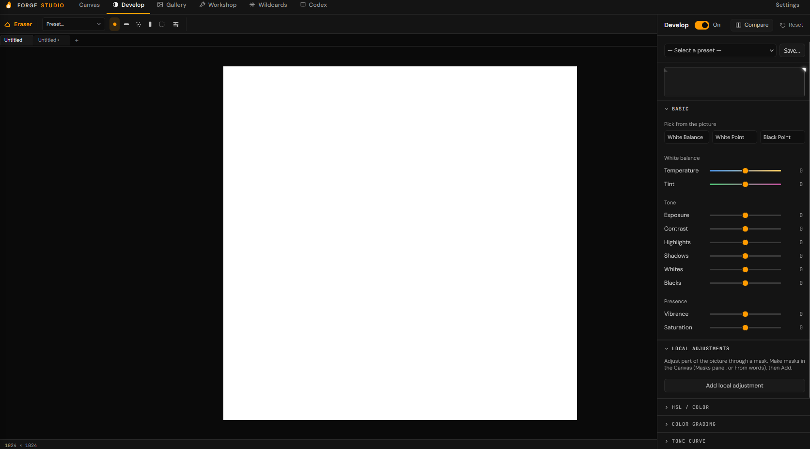

# Forge Studio

Forge Studio is a local image-generation app for Windows and NVIDIA GPUs. It
runs on your own computer, on the Forge Neo engine, and puts generation, a
painting Canvas, a Gallery and model tools in one window. You don't need Forge
or another web UI installed.

**Status: public beta (0.9.x).** It's in daily use, but expect rough edges.
See [what works and what doesn't](docs/studio/FEATURE_STATUS.md).
[Install](#install) · [Full tour](#whats-in-it)

## What sets it apart



- **Word heatmaps.** Anima and SDXL pictures keep a record of where each prompt
  word landed, in a small file per picture. In the Gallery, click a word to see
  it on the picture. On by default; pictures are byte-identical with it on or
  off.
- **Masks and detail from prompt words.** Pick a word and Studio makes a mask
  from it: an object with a crisp edge, a soft area such as sky or glow, or
  everything else. A Word Detail slot in Auto Detail repaints where a word
  landed, for things a face detector can't find.
- **Regional prompting on any model.** Any number of regions. Attention Couple on
  SD 1.5 and SDXL, masked prompts on the rest. Hires keeps the regions, and Auto
  Detail fixes a face with its region's prompt. Checked on SDXL, Anima and
  FLUX.2 Klein.
- **A Refiner that works with Hires and Auto Detail** (text-to-image). A
  same-family model takes over at a step you choose, with its own LoRAs, and
  Hires and Auto Detail then run on it.
- **Outpaint from the Canvas.** Choose how far to extend each side. Studio fills
  the new space from the picture's edge on its own layer, repaints an overlap so
  the join is seamless, and can add a second pass over the new area at full
  detail.
- **Live Painting.** The model repaints your canvas after each stroke, into a
  preview pane, so your painting stays untouched until you apply a frame as a
  layer.
- **Anima prompt weights that change attention.** A weight like `(word:1.6)`
  changes how hard the model attends to that word, and brackets alone don't
  change the picture.

## What's in it

### Generate

- Text-to-image and image-to-image, Hires, inpainting, and a queue or Batch mode.
- **Hires Fix > Model** (text-to-image) runs the Hires pass and Auto Detail on
  another model with its own Text Encoder and VAE, including one of another
  family: an Anima base finished by SDXL, for example.
- **Auto Detail:** three slots, with detectors for faces, hands and people, each
  with its own prompt and LoRAs. While inpainting, faces your mask isn't on are
  left alone.
- **ControlNet:** three units for SD 1.5, SDXL and Anima (Control-LLLite), with
  Forge's preprocessors. Their models download the first time you use them.
- **FLUX.2 Klein reference images**, which can also take a ControlNet map.
- **Regions:** besides the methods above, One pass per region repaints each
  region of a canvas picture separately.
- **Extra samplers and scheduler:** BFS (Bandwise Flow), BFS Heun and Beta 57.
- **Upscaling:** an Upscale panel, and a faster half-precision option (off by
  default; fine detail can differ slightly).
- Tag and word autocomplete in the prompt box.
- A console warning when RAM runs short, and a restart if Studio stops
  unexpectedly, with the page saying why.

### Canvas



- **20 tools:** brush, eraser, inpaint mask, fill, gradient, shape, text, smudge,
  blur, dodge, clone, liquify, pixelate, four selection tools, eyedropper, crop
  and transform.
- **Brushes:** presets from Basic Round to Pencil, Ink Wash, Charcoal, Pastel and
  Bristle Rake, with paper grain and pen pressure; symmetry painting (including
  radial); Mix, which carries wet colour along the stroke so that blue and yellow
  make green.
- **Masks:** named masks in a Masks panel, made by painting or from prompt words,
  tones or a colour range. Use them for inpainting and Develop.
- **Without a model:** Smart Patch, Patch and Heal remove small things.
- **Layers and documents:** layers with blend modes, document tabs, Canvas Size,
  per-tool settings memory, and crash recovery that saves only what changed.
- **Files:** open and save PSD with layers and masks, Export EXR (from the 8-bit
  picture), and watermark stamping on export.

### Gallery

Built on Moritz's TrackImage. It browses the folders you link.

- Search across file names, character tags and embedded metadata (prompt, models,
  LoRAs).
- Ratings, a folder tree, and each picture's settings and word heatmaps.
- Find duplicates by how alike pictures look, with a similarity threshold.
- Bulk rename, move and delete, all undoable.

### Develop



- Photo-style white balance, tone and colour, HSL, colour grading, tone curve and
  detail, with before/after.
- Local adjustments through a named mask, including one made from a prompt word.
- Saved presets. Sliders render in a background worker, so dragging doesn't
  hold up the page.

### Workshop

- Weighted Sum, Add Difference and SLERP merges, with block weights.
- LoRA and VAE baking, multi-step chains, a searchable History and a basic
  Inspector.
- Anima files saved with different key prefixes merge as compatible.

### Everything else

- **Model folders:** add any number. Every subfolder is scanned and each file
  sorted by what it actually is. The Model lists group checkpoints by subfolder,
  and each folder folds.
- **LoRA and Checkpoint browsers** with previews, activation text and Civitai
  lookup when you ask for it.
- **Wildcards** with a built-in editor, a preview that resolves an entry,
  drag-to-move between folders, and zip export and import.
- **Layouts:** Classic or Deck, and a Customize mode to rearrange the panels.
- **Workflows:** named sets of settings to apply again later.
- Seven themes plus your own; English, German, Spanish and French.
- The **Codex**, a built-in guide, and interactive tours.

### Models

Studio works with SD 1.5, SDXL (including Illustrious and Pony), Anima and
FLUX.2 Klein models. The real-GPU checks so far were mostly on Anima and SDXL,
some on FLUX.2 Klein; SD 1.5 has had the least. The engine underneath has code
for other families, such as Chroma, Qwen-Image, Z-Image and Wan. They haven't been
checked in Studio.

## Not supported

Studio has its own interface on the Forge Neo engine, so these aren't available:

- Forge and A1111 extensions.
- X/Y/Z Plot and other scripts, such as Prompt Matrix, Loopback and prompts from
  a file.
- The public `/sdapi` API.
- Img2img resize modes, and img2img batch from a folder.
- Styles.
- Face restoration (GFPGAN, CodeFormer).
- Video generation.

## What you need

- Windows with an NVIDIA GPU and a current driver.
- [Git for Windows](https://git-scm.com/download/win) and
  [Python 3.13](https://www.python.org/downloads/) (64-bit).
- About 5 GB of free space for setup, plus room for your models.
- At least one model (a checkpoint). Studio doesn't download one for you.
  The first-run screen links two free ones to start with, and Civitai and
  Hugging Face have many more.

## Install

Open PowerShell in the folder where you want Studio, then run:

```powershell
git clone --depth 1 --branch release/tester-alpha-prep https://github.com/ToxicHost/sd-webui-forge-studio.git Forge-Studio
cd Forge-Studio
.\Start-Studio.bat
```

The first start takes a while: it sets up Python and downloads Torch and seven
small helper models (Auto Detail detectors, a mask model and an upscaler;
173 MB, each checked against a known hash). Then Studio opens in your browser
and asks where your models are.

After that, run `Start-Studio.bat` to start Studio.

More detail, including where your settings and pictures are kept:
[installation guide](docs/studio/GIT_INSTALL.md).

## Updating

In Studio, open **Settings > About > Check for Updates**. Or close Studio and
run `git pull --ff-only` in the Studio folder, then start it again. Nothing
updates on its own.

## Privacy

Studio runs on your computer and serves its pages only to your computer. No
telemetry or analytics. After setup, it goes online only for:

- Civitai lookup in the model browsers and Check for Updates, when you press
  them;
- a ControlNet preprocessor's model, downloaded the first time you use that
  preprocessor (the Generate button says so while it does).

## Other platforms

- **Mac (Apple Silicon):** [Mac install guide](docs/studio/MAC_INSTALL.md).
  Not yet tested on a real Mac.
- **Linux (NVIDIA):** an [experimental Docker setup](packaging/docker/README.md).
  Not yet tested end to end.
- AMD and Intel GPUs aren't supported yet.

## Problems and feedback

Send ToxicHost a message on the site where you found Studio.

When you report a problem, a support report helps. It's written to your
computer for you to look at first, and never sent anywhere automatically:

```powershell
.\venv\Scripts\python.exe scripts\build_support_bundle.py
```

The [user guide](docs/studio/USER_GUIDE.md) has more on backups and reports.

## Credits and licence

Forge Studio is made by ToxicHost and Moritz. It began as an extension for Forge
Neo. The Gallery is built on Moritz's TrackImage. Studio runs on
[Forge Neo](https://github.com/Haoming02/sd-webui-forge-classic/tree/neo),
and includes other open-source work listed in the
[credits](docs/studio/THIRD_PARTY_NOTICES.md) and
[model notes](docs/studio/BUNDLED_MODEL_ASSETS.md).

Licensed under the [AGPL-3.0-or-later](LICENSE). See the [notice](NOTICE.md).

- [Release notes](docs/studio/RELEASE_NOTES.md)
- [Dependency notes](docs/studio/DEPENDENCY_NOTES.md)
